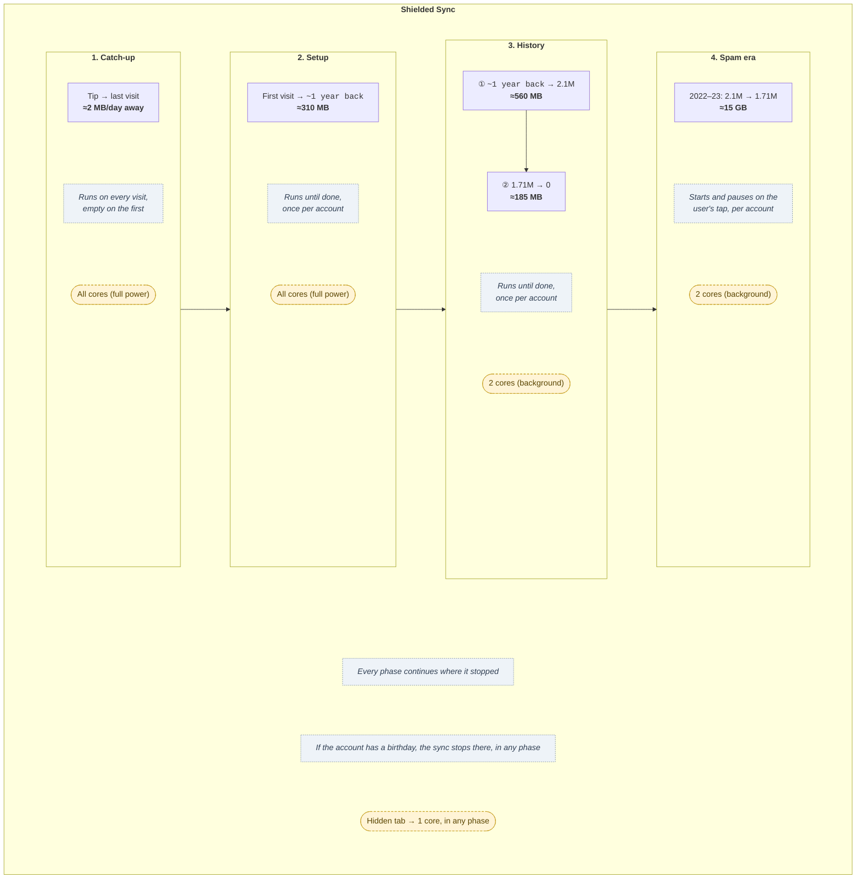

# Zillions App

The Zillions Zcash wallet web app. What it does: [docs/product.md](../../docs/product.md).

## Stack

- React + TypeScript + Vite
- Tailwind
- TanStack Router and Query
- Dexie (IndexedDB)
- [`@zillions/zcore`](../../packages/zcore) (Rust/wasm, built locally: see Setup)

## Setup

You'll need `node` (18.18+), `pnpm`, and what zcore's build needs:
[rustup](https://rustup.rs) and a clang that targets wasm32 (on macOS,
`brew install llvm`). From the repo root:

```bash
pnpm install
pnpm zcore:build
cp apps/app/.env.example apps/app/.env
```

Run `pnpm zcore:build` again after pulling zcore changes.

`.env.example` targets mainnet. For testnet, set `VITE_ZCASH_NETWORK=test`
and point `VITE_GRPC_URL` and `VITE_INDEXER_URL` at testnet servers.

The app signs through the Zillions Keychain extension. Download it from
https://zillions-app.netlify.app/zillions-keychain.zip, unzip it into a
folder, and load that folder in `chrome://extensions` (Developer mode → Load unpacked).
Or build it from source: see the [Keychain README](../keychain/README.md).

## Develop

```bash
pnpm app:dev
```

Opens on http://localhost:5173.

## Test

```bash
pnpm app:test
```

## Build

```bash
pnpm app:build
```

## Sync

The shielded sync reads each pool's chunks newest-first in four phases.
Details and measurements: [docs/design/sync-phases.md](../../docs/design/sync-phases.md).



- **~1 year back** is fixed at build time: `vite.config.ts` asks the indexer
  for each pool's chunk a year before its tip (`SETUP_CHUNKS`), so the build
  needs the indexer reachable. An account keeps the value from its first sync.
- **Spam era**: once history is done, the sync indicator explains why the
  spam era waits and offers "Sync spam era"; the user can pause and resume
  it. The choice is stored with the account (`spamSync`), so it resumes on
  later visits. Funds received in 2022–23 only show once it's read.
- **Speed up**: while history or the spam era runs, the sync indicator offers
  "Speed up", which moves it to every core until "Slow down" or a reload. A
  hidden tab still drops to 1 core.
- **Save data**: when the browser asks to save data
  (`navigator.connection.saveData`, Chromium only), history waits until the
  user taps "Download older history". The spam era needs the user's tap
  anyway.
- **Re-sync**: a minute after each sync ends, the wallet syncs again for new
  activity, unless history or the spam era is running (a sync would pause
  it); then it waits until they end. Catch-up skips pools with nothing new.
- **`VITE_ALLOW_CPU_TO_FRY=true`** runs every phase on every core, hidden tab
  or not. Handy for testing a full sync quickly.
- **Birthday**: a created account gets one from the device clock; an imported
  one has none, so its history runs back to each pool's start.
- Download sizes are worst case, measured on mainnet in October 2026: full
  chunks never change, so the browser's HTTP cache can make re-reads free.
