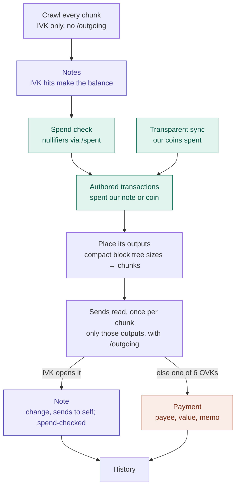

# History categories

How history decides what a transaction is. The types and their wording are
product.md 2.6; every concrete shape is in [activity-cases.md](activity-cases.md).

## Three facts, three sources

1. **Note**: an output that pays one of the account's addresses. Found by
   the incoming viewing key (IVK), whoever built the transaction. Notes
   make the balance.
2. **Authored**: the transaction spends one of the account's notes (its
   nullifier is on chain) or one of its transparent coins. Only the
   spending key can do that, so it's proof. An outgoing copy opened with
   the account's OVK is **not** proof: anyone holding the viewing key, as
   every connected site does, can seal an output with it.
3. **Payment**: an output of an authored transaction that pays someone
   else. Its payee, value and memo come from the outgoing viewing key
   (OVK); a transparent one is public. The OVK is only tried on authored
   transactions.

Everything from "Place its outputs" on runs at the end of each sync run. A
transaction is marked read once all its chunks are; one whose chunk failed or
isn't indexed yet is read again next run.

## Authored or not

|                  | Not authored                 | Authored                                                                   |
| ---------------- | ---------------------------- | -------------------------------------------------------------------------- |
| Shows in history | if it pays the account       | always                                                                     |
| Amount           | + what it paid the account   | what left the account (spent − change), "−" only when it paid someone else |
| Fee              | not the account's, not shown | the account's                                                              |
| Payees           | none                         | its payments                                                               |
| Type             | Received                     | from its outputs, below                                                    |

## An authored transaction's type

| Its outputs                                    | Type                                              | Example                           |
| ---------------------------------------------- | ------------------------------------------------- | --------------------------------- |
| Some pay someone else                          | **Sent**, to them                                 | a payment, several recipients     |
| All the account's, transparent → shielded      | **Shielded**                                      | shielding                         |
| All the account's, shielded → transparent      | **Unshielded**                                    | unshielding                       |
| All the account's, one shielded pool → another | **Migrated**                                      | ZIP 318 steps, Sapling → Ironwood |
| All the account's, same pool                   | **Sent**, to "Shielded" or "Transparent", no sign | consolidating notes               |
| Funds a payment link                           | **Payment link**                                  | product.md 2.10                   |

A link's claim or cancel spends the link's note, not the account's, so it's
not authored: it shows as Received, from "Payment link".
